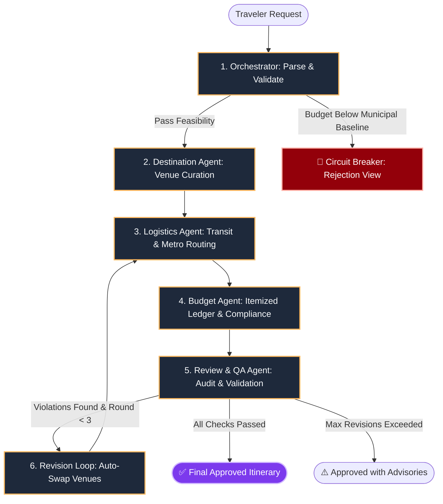

<div align="center">

# 🏜️ DUBAI AI TRAVEL PLANNER
### Autonomous Multi-Agent Itinerary Orchestrator

[](https://www.python.org/)
[](https://langchain-ai.github.io/langgraph/)
[](https://streamlit.io/)
[](https://groq.com/)
[](https://ollama.ai/)
[](https://github.com/Shashikiran-R/multi-agent-travelplanner)
[](LICENSE)

*A production-grade, stateful multi-agent travel concierge that generates hyper-optimized, thermally safe, and financially validated Dubai itineraries in seconds with **zero API operational costs**.*

[Live Demo](https://dubai-travelplanner.streamlit.app/) • [Architecture](docs/architecture.md) • [Deployment Guide](docs/deployment-plan.md) • [Design System](docs/DESIGN.md)

---

</div>

## 🌟 Overview

The **Dubai AI Travel Planner** transforms natural language trip directives into mathematically coherent, geographically clustered, and schedule-validated multi-day itineraries for the Emirate of Dubai. 

Unlike conventional single-prompt LLM wrappers, this system utilizes a **stateful cyclic graph architecture (LangGraph)** where 5 specialized agents collaborate, critique, and revise the travel plan until all physical, municipal, and financial constraints are met.

```
"Plan a 4-day cultural and foodie trip to Dubai with luxury lodging and AED 4,500 budget in July"
                                      │
                                      ▼
             [ Real-Time Sidebar Budget Feasibility Check ]
                   ⚠️ Insufficient by AED 1,070
              [ ⚡ One-Click Auto-Fix to AED 5,570 ]
                                      │
                                      ▼
                      [ LangGraph Multi-Agent Engine ]
           Orchestrator ➔ Destination ➔ Logistics ➔ Budget
                                      │
                                      ▼
                        [ Review & QA Agent Audit ]
                  (Ollama Cloud nemotron-3-ultra)
                   ┌──────────────────┴──────────────────┐
               [Passed]                              [Violations]
                   │                                     │
                   ▼                                     ▼
        Approved Itinerary View               Auto-Revision Cycle (≤3)
  (Timeline + Map + Budget + Telemetry)      (Swap Over-Budget Venues)
```

---

## ⚡ Key Highlights

- **🧠 Specialized Multi-Agent Swarm**: Separation of concerns across Orchestrator, Destination Research, Logistics Planning, Budget Accounting, and Quality Review.
- **🛡️ Review & QA Circuit Breaker**: Evaluates every generated plan for municipal tax compliance (Tourism Dirham, 5% VAT), seasonal heat indexes, and opening hours using **Ollama (`nemotron-3-ultra`)**. Automatically triggers revision loops when defects are caught.
- **⚡ Real-Time Budget Feasibility Engine**: Instant pre-generation calculation validating duration, accommodation tier nightly rates, and subsistence baselines. Features dynamic warning alerts and a **1-click auto-fix button**.
- **🚇 RTA Mobility & Geographic Grounding**: Reroutes transit via the **Dubai Metro network (35 stations, Red & Green lines)**, Silver Nol fare zones, traditional Creek abra crossings, and taxis with real kilometer matrices.
- **☀️ Thermal & Seasonal Awareness**: Open-Meteo climate intelligence automatically reroutes midday activities to air-conditioned indoor mega-structures during extreme summer months (May–September).
- **💸 $0.00 Operational API Cost**: Powered by Groq's high-speed free-tier LPUs (`openai/gpt-oss-120b`) and Ollama, backed by a **100% deterministic offline calculation engine** that engages if remote APIs are unavailable.
- **🎨 Nocturne Oasis Luxury Dark Theme**: Bespoke component-based UI crafted with Google Stitch, featuring Syne & Geist typography, glassmorphism cards, interactive Leaflet/Folium maps, and Plotly financial analytics.

---

## 🏗️ Multi-Agent Architecture



### Agent Roster

| Agent | Core Responsibility | Model / Engine |
|---|---|---|
| **Orchestrator Agent** | Parses natural language directives, extracts structured `UserConstraints`, runs circuit breakers. | Groq `openai/gpt-oss-120b` |
| **Destination Agent** | Queries curated SQLite database (196 Dubai venues), clusters by district, enforces thermal rules. | Groq `openai/gpt-oss-120b` |
| **Logistics Agent** | Connects consecutive venues using Dubai Metro (35 stations), Abra routes, and taxi matrices. | Dubai RTA Math Engine |
| **Budget Agent** | Calculates itemized hotel, dining, transit, and attraction costs in AED; evaluates limits. | Pydantic Financial Ledger |
| **Review & QA Agent** | Audits draft against Dubai laws, thermal safety, opening hours; generates revision directives. | Ollama `nemotron-3-ultra` |

---

## 🖥️ User Interface & Dashboard

The application features 4 interactive dashboard views:

| View | Features |
|---|---|
| **📅 Itinerary Timeline** | Day-by-day expandable accordions, district color badges, morning/afternoon/evening activity cards, and inter-activity transit steps. |
| **🗺️ Interactive Map & Metro** | Fullscreen Leaflet map centered on Dubai with color-coded day markers, dashed route polylines, and all 35 Dubai Metro stations. |
| **💰 Financial Ledger** | 4 metric summaries (Budget, Spend, Buffer, Compliance), Plotly category donut chart, budget utilization gauge, and itemized ledger table. |
| **🤖 Observability Trace** | Review Agent audit report, constraint violation badges, and sequential multi-agent execution telemetry stream. |

---

## 🚀 Quickstart

### Prerequisites
- Python 3.11+
- Git

### 1. Clone Repository
```bash
git clone https://github.com/Shashikiran-R/multi-agent-travelplanner.git
cd multi-agent-travelplanner
```

### 2. Set Up Virtual Environment
```bash
python3 -m venv .venv
source .venv/bin/activate  # On Windows: .venv\Scripts\activate
pip install -r requirements.txt
```

### 3. Configure Environment Variables
Copy the template and supply your keys (free tier available):
```bash
cp .env.example .env
```

Edit `.env`:
```ini
# Groq API Key (Free at https://console.groq.com)
GROQ_API_KEY=gsk_your_groq_api_key_here
GROQ_MODEL=openai/gpt-oss-120b

# Ollama Endpoint (Local or Cloud)
OLLAMA_BASE_URL=http://localhost:11434
OLLAMA_MODEL=nemotron-3-ultra
OLLAMA_API_KEY=your_ollama_api_key_if_cloud
```
> **Note**: If API keys are omitted, the planner runs in **100% deterministic offline fallback mode** ($0.00 cost) with full functionality.

### 4. Run Application
```bash
streamlit run app.py
```
Open **`http://localhost:8501`** in your browser.

---

## ☁️ Deployment on Streamlit Community Cloud

The repository is pre-configured for one-click deployment on [Streamlit Community Cloud](https://share.streamlit.io):

1. Fork or push this repository to your GitHub.
2. Sign in to **[share.streamlit.io](https://share.streamlit.io)**.
3. Click **"New app"** and enter:
   - **Repository**: `YourUsername/multi-agent-travelplanner`
   - **Branch**: `main`
   - **Main file path**: `app.py` (or `streamlit_app.py`)
4. In **Advanced Settings → Secrets**, paste:
   ```toml
   GROQ_API_KEY = "gsk_your_actual_key"
   GROQ_MODEL = "openai/gpt-oss-120b"
   OLLAMA_BASE_URL = "https://api.ollama.ai"
   OLLAMA_API_KEY = "your_ollama_key"
   OLLAMA_MODEL = "nemotron-3-ultra"
   ```
5. Click **Deploy!**

For detailed deployment strategies, edge-case handling, and monitoring, read the **[Deployment Guide](docs/deployment-plan.md)**.

---

## 📂 Project Structure

```
tripplanner/
├── app.py                         # Main Streamlit UI & Dashboard
├── streamlit_app.py               # Streamlit Cloud deployment entry point
├── requirements.txt               # Pinned Python dependencies
├── .env.example                   # Environment configuration template
├── .streamlit/
│   └── config.toml                # Headless settings & dark theme tokens
├── src/
│   ├── agents/                    # Multi-agent implementations
│   │   ├── orchestrator.py        # Intent parsing & circuit breaker
│   │   ├── destination.py         # Venue research & district clustering
│   │   ├── logistics.py           # Metro routing & transit sequencing
│   │   ├── budget.py              # Financial accounting & ledgering
│   │   └── review.py              # Review & QA audit agent
│   ├── graph/                     # LangGraph cyclic state machine
│   │   ├── state.py               # TravelPlannerState schema
│   │   ├── nodes.py               # Agent execution nodes
│   │   ├── edges.py               # Conditional routing logic
│   │   └── workflow.py            # Graph compiler & execution wrapper
│   ├── data_access/               # SQLite client & OpenStreetMap parser
│   ├── models/                    # Pydantic v2 data contracts
│   ├── tools/                     # Routing, budget, and validation tools
│   └── utils/                     # LLM factory (Groq & Ollama)
├── data/
│   ├── dubai_travel.db            # SQLite database (196 venues, 35 metro stations)
│   ├── seed_data.json             # Seed data backup
│   └── rta_transit_matrix.json    # Dubai transit distance & fare matrix
├── docs/                          # Architecture & design documentation
│   ├── architecture.md            # Complete system architecture specification
│   ├── deployment-plan.md         # Cloud deployment and operations guide
│   ├── implementation.md          # Implementation milestones and history
│   ├── problemstatement.md        # Technical problem statement
│   ├── research.md                # Dubai travel domain research
│   └── DESIGN.md                  # Nocturne Oasis design system tokens
└── tests/                         # Test suite (60+ unit & integration tests)
    ├── test_agents.py
    ├── test_graph.py
    ├── test_schemas.py
    ├── test_tools.py
    └── test_ui.py
```

---

## 🧪 Testing

Run the full test suite (schemas, tools, agents, graph, and UI):

```bash
# Run all unit and integration tests
python -m unittest discover tests

# Run UI-specific AppTest suite
python -m unittest tests/test_ui.py
```

---

## 📚 Documentation

- **[System Architecture](docs/architecture.md)** — In-depth graph flow, state schemas, and agent prompting protocols.
- **[Deployment Plan](docs/deployment-plan.md)** — Streamlit Cloud launch, secrets management, and troubleshooting.
- **[Design System](docs/DESIGN.md)** — Nocturne Oasis luxury design tokens, Syne/Geist typography, and color palettes.
- **[Dubai Domain Research](docs/research.md)** — Municipal taxes, RTA Nol zones, and thermal safety parameters.

---

## 📄 License

This project is open-source and available under the [MIT License](LICENSE).

<div align="center">
<sub>Crafted with precision for modern autonomous multi-agent travel planning.</sub>
</div>
