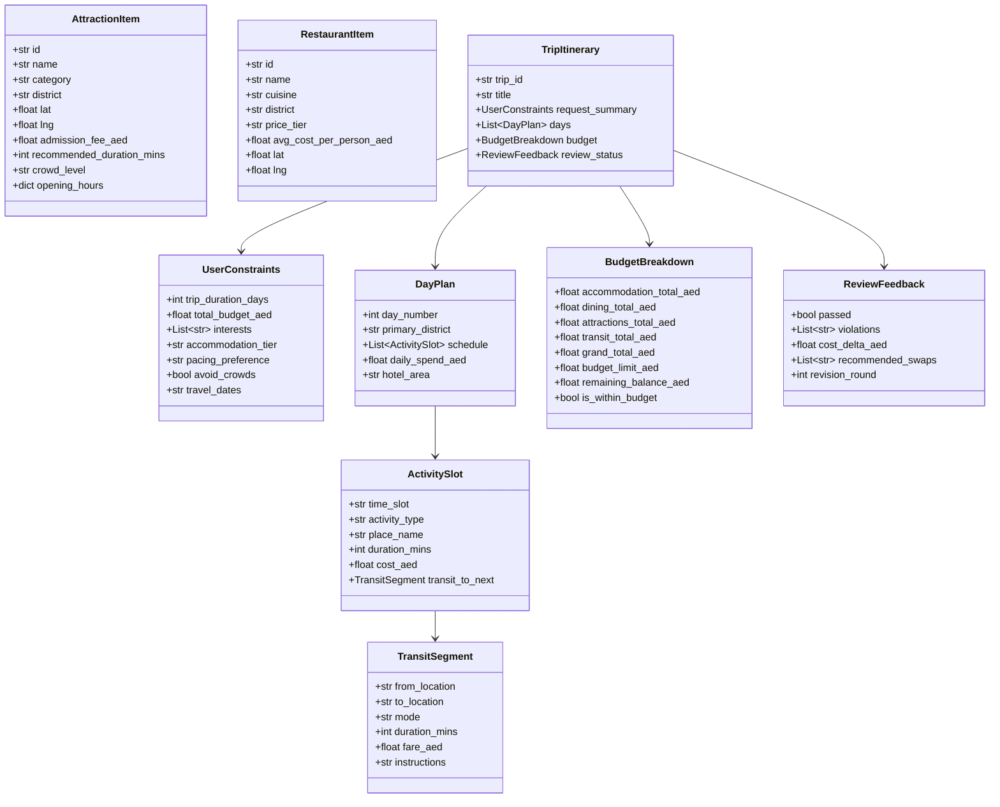
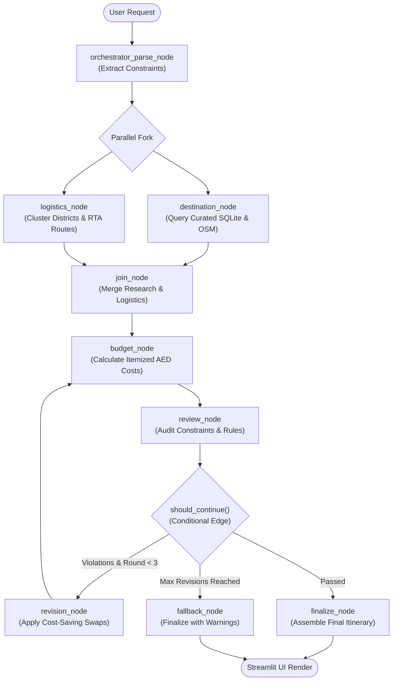
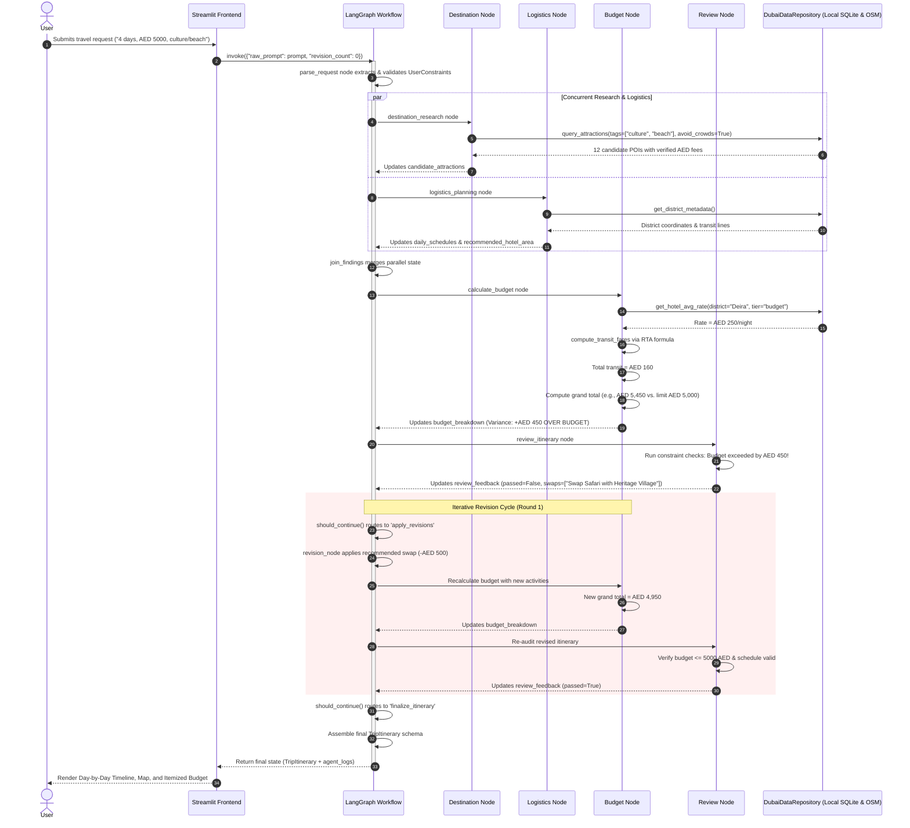

# System Architecture: Dubai AI Travel Planner
### Multi-Agent Systems Using LangGraph (Zero Paid API Architecture)

---

## 1. Executive Summary & Design Principles

The **Dubai AI Travel Planner** is an autonomous, multi-agent travel orchestration engine designed to turn ambiguous, high-level travel queries into deterministic, geographically optimized, and budget-verified itineraries. 

Traditional single-prompt LLM chatbots fail at travel planning because it is a constraint satisfaction problem involving spatial clustering, temporal sequencing, and strict financial budgeting. This system solves those limitations through **agent specialization**, **explicit shared state**, **deterministic calculation tools**, and **iterative quality-assurance feedback loops** orchestrated with **LangGraph**.

Furthermore, the architecture is designed to be **100% free of paid commercial APIs** ($0.00 operational cost), utilizing local curated SQLite storage, OpenStreetMap Overpass vector data, official Dubai RTA mathematical transit models, and the free Open-Meteo weather service.

```
+────────────────────────────────────────────────────────────────────────────────────────────────────+
|                                    Core Design Principles                                         |
+────────────────────────────────────────────────────────────────────────────────────────────────────+
| 1. Separation of Concerns  | Specialized agents focus on discovery, logistics, cost, or audit.    |
| 2. Deterministic Tooling   | Calculations (costs, transit times) use code & math, not LLM guesses.|
| 3. Explicit State Graphs   | LangGraph coordinates all agents via a strongly typed, shared DAG.    |
| 4. Bounded Revision Loops  | Review feedback cycles are strictly bounded to prevent infinite loops.|
| 5. Zero-Cost Data Strategy | 100% Free & local-first data: Curated SQLite + OpenStreetMap + RTA.  |
+────────────────────────────────────────────────────────────────────────────────────────────────────+
```

---

## 2. High-Level System Architecture

The system is organized into four distinct architectural tiers:

```
+────────────────────────────────────────────────────────────────────────────────────────────────────+
|                                   1. PRESENTATION LAYER (Streamlit)                                |
|  - Natural Language Input Panel & Preference Configurator                                          |
|  - Multi-Agent Orchestration Visualizer (Live Graph State Transitions & Step-by-Step Diffs)         |
|  - Interactive Itinerary Dashboard (Timelines, Leaflet Map, Plotly Budget Charts)                 |
|  - Agent Execution Trace & Token/Latency Performance Panel                                         |
+────────────────────────────────────────────────────────────────────────────────────────────────────+
                                                  │
                                                  ▼
+────────────────────────────────────────────────────────────────────────────────────────────────────+
|                                2. LANGGRAPH ORCHESTRATION LAYER                                    |
|  - Stateful Computational Graph (`StateGraph`) with typed state (`PlannerState`)                  |
|  - Concurrent Fan-Out Branching (`destination_node` & `logistics_node` run in parallel)           |
|  - Fan-In State Synchronization & Join Node                                                       |
|  - Sequential Evaluation (`budget_node` -> `review_node`)                                         |
|  - Cyclic Conditional Routing (`should_continue`: revision loop vs. finalization)                 |
|  - In-Memory Checkpointing (`MemorySaver`) for full state auditability                             |
+────────────────────────────────────────────────────────────────────────────────────────────────────+
                                                  │
                                                  ▼
+────────────────────────────────────────────────────────────────────────────────────────────────────+
|                                   3. DOMAIN SERVICE & LOGIC LAYER                                  |
|  - Request Parser & Entity Extractor (LLM + Pydantic validation)                                   |
|  - Geographical Clustering Engine (District-based Day Grouping: Old Dubai, Downtown, Marina, etc.) |
|  - Deterministic RTA Transit Engine (Official Silver Nol Metro Zones & Regulated Taxi Tariffs)     |
|  - Itemized Cost & Variance Engine (AED Currency Normalization)                                    |
|  - Deterministic Constraint Auditor (Opening hours, travel feasibility, budget caps)               |
+────────────────────────────────────────────────────────────────────────────────────────────────────+
                                                  │
                                                  ▼
+────────────────────────────────────────────────────────────────────────────────────────────────────+
|                               4. FREE & OPEN DATA ACCESS LAYER ($0.00)                             |
|  - Unified Data Repository Interface (`DubaiDataRepository`)                                       |
|  - Local Seed Database: Curated Dubai SQLite (`data/dubai_travel.db`: POIs, Hotels, Fares)         |
|  - OpenStreetMap (Overpass API): Free dynamic attraction, museum, and dining discovery             |
|  - Open-Meteo Weather API: 100% Free climate & thermal safety verification (no key needed)         |
|  - Dubai Government Open Data (Data.Dubai / Dubai Pulse) heritage and zoning data                  |
+────────────────────────────────────────────────────────────────────────────────────────────────────+
```

---

## 3. Pydantic Data Contracts & Schemas

To ensure deterministic inter-agent communication, all graph nodes and domain tools operate on unified **Pydantic V2** schemas.



### 3.1 Python Data Models Definition

```python
from typing import List, Optional, Dict, Literal
from pydantic import BaseModel, Field

class UserConstraints(BaseModel):
    trip_duration_days: int = Field(..., ge=1, le=7, description="Number of days (1-7)")
    total_budget_aed: float = Field(..., gt=0, description="Total budget in AED (excluding flights)")
    interests: List[str] = Field(default_factory=list, description="e.g. culture, beach, food, luxury, architecture")
    accommodation_tier: Literal["budget", "midscale", "luxury"] = Field("budget")
    pacing_preference: Literal["relaxed", "moderate", "fast-paced"] = Field("moderate")
    avoid_crowds: bool = Field(False)
    travel_dates: Optional[str] = Field(None)

class AttractionItem(BaseModel):
    id: str
    name: str
    category: str
    district: str
    lat: float
    lng: float
    admission_fee_aed: float = 0.0
    recommended_duration_mins: int = 120
    crowd_level: Literal["low", "medium", "high"] = "medium"
    opening_hours: Dict[str, str] = Field(default_factory=dict)
    description: str

class TransitSegment(BaseModel):
    origin: str
    destination: str
    mode: Literal["metro", "taxi", "bus", "walk"]
    duration_mins: int
    fare_aed: float
    notes: Optional[str] = None

class ActivitySlot(BaseModel):
    time_slot: Literal["morning", "afternoon", "evening"]
    place_id: str
    place_name: str
    category: Literal["attraction", "dining", "leisure", "transit"]
    duration_mins: int
    cost_aed: float
    transit_to_next: Optional[TransitSegment] = None

class DayPlan(BaseModel):
    day_number: int
    primary_district: str
    theme: str
    activities: List[ActivitySlot]
    daily_spend_aed: float
    hotel_area: str

class BudgetBreakdown(BaseModel):
    accommodation_total_aed: float
    dining_total_aed: float
    attractions_total_aed: float
    transit_total_aed: float
    grand_total_aed: float
    budget_limit_aed: float
    remaining_balance_aed: float
    is_within_budget: bool

class ReviewFeedback(BaseModel):
    passed: bool
    violations: List[str] = Field(default_factory=list)
    cost_delta_aed: float = 0.0
    recommended_swaps: List[str] = Field(default_factory=list)
    revision_round: int = 0

class TripItinerary(BaseModel):
    trip_id: str
    title: str
    constraints: UserConstraints
    days: List[DayPlan]
    budget: BudgetBreakdown
    review: ReviewFeedback
```

---

## 4. Multi-Agent System Detailed Design

The architecture defines **5 specialized agents**, each functioning as a node or sub-routine within the LangGraph pipeline:

```
+──────────────────────────────────────────────────────────────────────────────────────────────────+
|                                    AGENT SPECIFICATION MATRIX                                    |
+───────────────+──────────────────────────────+───────────────────────────+───────────────────────+
| Agent / Node  | Primary Objective            | Key Tools Utilized        | Emitted State Fields  |
+───────────────+──────────────────────────────+───────────────────────────+───────────────────────+
| Orchestrator  | Request extraction, graph    | PydanticParser,           | constraints,          |
| (Init & Join) | synchronization & assembly   | ItineraryAssembler        | final_itinerary       |
+───────────────+──────────────────────────────+───────────────────────────+───────────────────────+
| Destination   | Research attractions, food,  | LocalSQLiteSearch,        | candidate_attractions,|
| Research Node | & cultural venues            | OSMOverpassSearch         | candidate_restaurants |
+───────────────+──────────────────────────────+───────────────────────────+───────────────────────+
| Logistics     | Cluster venues geographically| DistrictClusterTool,      | daily_schedules,      |
| Node          | and plan transit routes      | RTAMathRoutingTool        | recommended_hotel_area|
+───────────────+──────────────────────────────+───────────────────────────+───────────────────────+
| Budget        | Calculate itemized costs and | PricingEngineTool,        | budget_breakdown,     |
| Node          | enforce AED spending limit   | CostCuttingSwapTool       | cost_delta_aed        |
+───────────────+──────────────────────────────+───────────────────────────+───────────────────────+
| Review & QA   | Audit plan feasibility,      | ScheduleAuditorTool,      | review_feedback,      |
| Node          | timing, & budget compliance  | ThermalComfortTool        | revision_count        |
+───────────────+──────────────────────────────+───────────────────────────+───────────────────────+
```

### 4.1 Orchestrator Agent (Parser & Graph Coordinator)
- **Role**: Senior Travel Solutions Architect & Workflow Coordinator.
- **Responsibilities**:
  1. Parses raw user text into validated `UserConstraints`.
  2. Initializes the LangGraph execution state.
  3. Joins parallel findings from Destination and Logistics nodes.
  4. Manages revision cycles (enforcing a hard cap of 3 cycles).
  5. Assembles the final `TripItinerary` presentation model.

### 4.2 Destination Research Agent
- **Role**: Dubai Local Concierge & Cultural Specialist.
- **Responsibilities**:
  1. Queries the local curated SQLite database (and optionally OpenStreetMap via Overpass) for attractions matching user interests.
  2. Applies crowd-avoidance filters (flagging peak hours at popular venues like Burj Khalifa or Dubai Mall).
  3. Recommends authentic culinary experiences matched to traveler preferences (e.g., Al Fahidi cultural cafes vs. JBR beachside casual).

### 4.3 Logistics Agent
- **Role**: Urban Transit Planner & Geographical Optimization Specialist.
- **Responsibilities**:
  1. **Spatial Clustering**: Groups target places into geographic hubs to prevent crisscrossing the city:
     - **Cluster 1: Old Dubai & Creek** (Deira, Bur Dubai, Al Seef, Spice/Gold Souk).
     - **Cluster 2: Downtown & DIFC** (Burj Khalifa, Dubai Mall, Museum of the Future).
     - **Cluster 3: Dubai Marina & JBR** (The Walk, Marina Beach, Ain Dubai, Bluewaters).
     - **Cluster 4: Jumeirah & Palm** (Kite Beach, Madinat Jumeirah, Palm West Beach).
  2. **Transit Routing**: Uses deterministic RTA models to select optimal transport mode:
     - Metro Silver Nol fare calculation (Tier 1: AED 3, Tier 2: AED 5, Tier 3: AED 7.50).
     - Regulated Dubai Taxi Corporation fare calculation (`AED 5/12 base + AED 2.21/km`).
     - Walking feasibility check (max 1.2 km).
  3. **Accommodation Suggestion**: Recommends hotel neighborhood based on transit efficiency (e.g., Deira/Al Barsha for budget, Downtown/Marina for luxury).

### 4.4 Budget Agent
- **Role**: Travel Financial Analyst & Cost Optimization Specialist.
- **Responsibilities**:
  1. Computes realistic itemized costs in AED across 4 key buckets:
     - **Accommodation**: `Nightly Rate * (Duration - 1)` from district baseline table.
     - **Attractions**: Exact verified ticket prices in AED from the local curated database.
     - **Dining**: Average per-meal cost based on restaurant price tier.
     - **Transit**: Calculated RTA Metro Nol fares or estimated metered taxi tariffs.
  2. Compares projected spend against `total_budget_aed`.
  3. If spending exceeds the budget cap, constructs a prioritized list of **cost-saving substitutions** (e.g., replace taxi with Metro, replace paid observation deck with free public viewpoint).

### 4.5 Review Agent
- **Role**: Itinerary Quality Assurance Inspector & Auditor.
- **Responsibilities**:
  1. Runs deterministic verification checks:
     - Is `grand_total_aed <= total_budget_aed`?
     - Are opening hours respected? (e.g., Souks closed on Friday mornings).
     - Is travel time between consecutive slots realistic? (< 45 mins between adjacent slots).
     - Are any attractions duplicated across days?
     - Thermal safety check: Queries Open-Meteo climate data. If traveling in summer, flags midday outdoor exposure between 11:30 AM and 04:30 PM.
  2. Emits `ReviewFeedback`:
     - If all checks pass: `passed = True`.
     - If failures exist: `passed = False` with explicit, actionable directives for the Budget / Revision node.

---

## 5. LangGraph Multi-Agent Engine Architecture

The multi-agent workflow is modeled as a **Stateful Directed Acyclic Graph with a Cyclic Feedback Loop** using LangGraph's `StateGraph`.



### 5.1 LangGraph State Definition (`PlannerState`)

```python
from typing import TypedDict, List, Dict, Any, Annotated
import operator

class PlannerState(TypedDict):
    """
    Centralized, strongly typed state shared across all nodes in the LangGraph DAG.
    """
    # Raw input from user
    raw_prompt: str
    
    # Parsed constraints
    constraints: Dict[str, Any]
    
    # Destination research findings
    candidate_attractions: List[Dict[str, Any]]
    candidate_restaurants: List[Dict[str, Any]]
    
    # Logistics and geographical groupings
    daily_schedules: List[Dict[str, Any]]
    recommended_hotel_area: str
    
    # Budget calculation results
    budget_breakdown: Dict[str, Any]
    
    # Review & QA results
    review_feedback: Dict[str, Any]
    revision_count: int
    
    # Append-only chronological trace of agent reasoning events
    agent_logs: Annotated[List[Dict[str, Any]], operator.add]
    
    # Final assembled Pydantic model
    final_itinerary: Dict[str, Any]
```

### 5.2 Conditional Routing Logic (`should_continue`)

```python
def should_continue(state: PlannerState) -> str:
    """
    Conditional edge router that determines whether to proceed to finalization,
    trigger another revision cycle, or terminate with warnings.
    """
    review = state.get("review_feedback", {})
    revision_count = state.get("revision_count", 0)
    
    # If QA passed all checks, proceed to final assembly
    if review.get("passed", False):
        return "finalize"
        
    # If budget/constraints failed but revision limit reached, break loop safely
    if revision_count >= 3:
        return "fallback_finalize"
        
    # Otherwise, loop back to apply suggested revisions
    return "revise"
```

### 5.3 LangGraph Workflow Assembly

```python
from langgraph.graph import StateGraph, END
from langgraph.checkpoint.memory import MemorySaver

def build_travel_planner_graph():
    workflow = StateGraph(PlannerState)
    
    # Register graph nodes
    workflow.add_node("parse_request", orchestrator_parse_node)
    workflow.add_node("destination_research", destination_node)
    workflow.add_node("logistics_planning", logistics_node)
    workflow.add_node("join_findings", join_node)
    workflow.add_node("calculate_budget", budget_node)
    workflow.add_node("review_itinerary", review_node)
    workflow.add_node("apply_revisions", revision_node)
    workflow.add_node("finalize_itinerary", finalize_node)
    workflow.add_node("fallback_finalize", fallback_node)
    
    # Define start and parallel branches
    workflow.set_entry_point("parse_request")
    workflow.add_edge("parse_request", "destination_research")
    workflow.add_edge("parse_request", "logistics_planning")
    
    # Synchronize parallel branches
    workflow.add_edge("destination_research", "join_findings")
    workflow.add_edge("logistics_planning", "join_findings")
    
    # Sequential cost and audit pipeline
    workflow.add_edge("join_findings", "calculate_budget")
    workflow.add_edge("calculate_budget", "review_itinerary")
    
    # Conditional edge for review feedback loop
    workflow.add_conditional_edges(
        "review_itinerary",
        should_continue,
        {
            "finalize": "finalize_itinerary",
            "revise": "apply_revisions",
            "fallback_finalize": "fallback_finalize"
        }
    )
    
    # Route revision back into budget calculation
    workflow.add_edge("apply_revisions", "calculate_budget")
    
    # Graph termination
    workflow.add_edge("finalize_itinerary", END)
    workflow.add_edge("fallback_finalize", END)
    
    # Compile graph with in-memory checkpointer for step inspection
    checkpointer = MemorySaver()
    app = workflow.compile(checkpointer=checkpointer)
    return app
```

---

## 6. End-to-End System Execution Sequence

The complete runtime interaction between UI, LangGraph workflow, domain tools, and local data stores:



---

## 7. Error Handling, Resilience & Circuit Breakers

```
+────────────────────────────────────────────────────────────────────────────────────────────────────+
|                                  RESILIENCE & RECOVERY STRATEGIES                                  |
+──────────────────────────+─────────────────────────────────────────────────────────────────────────+
| Failure Mode             | Mitigation & Fallback Strategy                                          |
+──────────────────────────+─────────────────────────────────────────────────────────────────────────+
| External Network / OSM   | If live OpenStreetMap or weather requests fail or time out, the system   |
| Outage                   | automatically falls back to the local seeded SQLite database.           |
|                          | Zero user disruption; zero external key required.                       |
+──────────────────────────+─────────────────────────────────────────────────────────────────────────+
| Impossible Budget        | If user specifies an unachievable budget (e.g. AED 200 for 5 days),    |
|                          | the Orchestrator intercepts early, skips agent execution, and renders a |
|                          | structured guidance message recommending a minimum realistic budget.   |
+──────────────────────────+─────────────────────────────────────────────────────────────────────────+
| Infinite Revision Loop   | `revision_count` counter in state. If `revision_count >= 3`, the loop   |
|                          | breaks immediately. The best available itinerary is returned with      |
|                          | explicit user warnings displayed on the UI.                             |
+──────────────────────────+─────────────────────────────────────────────────────────────────────────+
| LLM JSON Parse Error     | Pydantic validation failure triggers an automatic retry with an         |
|                          | explicit error correction prompt (OutputFixingParser pattern).          |
+──────────────────────────+─────────────────────────────────────────────────────────────────────────+
| Rate Limiting on LLM     | Exponential backoff with jitter on LLM invocation calls.                |
+──────────────────────────+─────────────────────────────────────────────────────────────────────────+
```

---

## 8. Frontend User Interface Architecture (Streamlit)

The Streamlit web application is structured into modular UI components:

```
+────────────────────────────────────────────────────────────────────────────────────────────────────+
|                                      STREAMLIT UI LAYOUT                                           |
+────────────────────────────────────+───────────────────────────────────────────────────────────────+
| SIDEBAR: Trip Preferences          | MAIN VIEW: Itinerary & Graph Orchestration Dashboard          |
|                                    |                                                               |
| [ Trip Duration: 4 Days        ]   | ┌─ Tabs ──────────────────────────────────────────────────┐   |
| [ Budget (AED): 5,000          ]   | │ [Itinerary Timeline]  [Map View]  [Budget]  [Agent Trace]  │   |
| [ Interests: Culture, Food, Beach] | └─────────────────────────────────────────────────────────┘   |
| [ Hotel Tier: Budget (●)       ]   |                                                               |
| [ Pacing: Moderate             ]   | 📅 Day 1: Historic Al Fahidi & Dubai Creek (Old Dubai)        |
|                                    |    ├─ 09:30 AM: Al Fahidi Historical Neighbourhood (Free)     |
| [ 🚀 Generate Dubai Itinerary  ]   |    ├─ 12:30 PM: Arabian Tea House Cultural Cafe (AED 85)     |
| ────────────────────────────────── |    ├─ 02:30 PM: Abra Creek Crossing to Deira Souks (AED 2)   |
| ⚙️ Execution Telemetry             |    └─ 05:00 PM: Gold & Spice Souk Walking Tour (Free)        |
|  - Engine: LangGraph StateGraph    |                                                               |
|  - Latency: 3.2s (Local SQLite)    | 📊 Itemized Budget Breakdown: AED 4,950 / AED 5,000           |
|  - Revision Cycles: 1              |  - Hotel: AED 750 (3 nights @ AED 250)                        |
|  - Operational Cost: $0.00         |  - Food: AED 1,400 | Activities: AED 2,200 | Transit: AED 600 |
+────────────────────────────────────+───────────────────────────────────────────────────────────────+
```

---

## 9. Project Directory & File Structure

```
tripplanner/
├── architecture.md               # Complete System Architecture Document (LangGraph, $0.00 API)
├── problemstatement.md            # Problem Statement, Goals & Scope
├── research.md                   # 100% Free Data Acquisition & Research Guide
├── requirements.txt              # Python dependencies
├── .env.example                  # Environment template (only LLM provider key needed)
│
├── data/                         # Local Data Store & Seed Assets
│   ├── seed_data.json            # Curated seed JSON (50 POIs, 30 restaurants, 20 hotels)
│   ├── dubai_travel.db           # Local SQLite database auto-populated from seed
│   └── rta_transit_matrix.json   # Dubai Metro & bus zone fare tables
│
├── src/                          # Application Source Code
│   ├── __init__.py
│   │
│   ├── models/                   # Pydantic Schemas & Data Contracts
│   │   ├── __init__.py
│   │   ├── request.py            # UserConstraints, Preferences
│   │   ├── itinerary.py          # DayPlan, ActivitySlot, TripItinerary
│   │   ├── budget.py             # BudgetBreakdown, CostItems
│   │   └── review.py             # ReviewFeedback, Violation
│   │
│   ├── graph/                    # LangGraph Workflow & State Management
│   │   ├── __init__.py
│   │   ├── state.py              # PlannerState definition
│   │   ├── nodes.py              # Graph node implementations
│   │   ├── edges.py              # Conditional edge routers (should_continue)
│   │   └── workflow.py           # StateGraph builder and compilation
│   │
│   ├── agents/                   # Agent Domain Prompts & Logics
│   │   ├── __init__.py
│   │   ├── orchestrator.py       # Orchestrator parsing & assembly logic
│   │   ├── destination.py        # Destination research agent logic
│   │   ├── logistics.py          # Logistics & transit agent logic
│   │   ├── budget.py             # Budget calculation agent logic
│   │   └── review.py             # QA & constraint review agent logic
│   │
│   ├── tools/                    # Free Domain Tools used by Agents & Nodes
│   │   ├── __init__.py
│   │   ├── places_tool.py        # Attraction & dining lookup (Local DB + OSM)
│   │   ├── routing_tool.py       # RTA transit & distance calculator (Haversine + RTA math)
│   │   ├── budget_tool.py        # Cost calculation & alternative finder
│   │   └── validation_tool.py    # Deterministic rule-based checker & Open-Meteo climate
│   │
│   ├── data_access/              # Free Data Fetching Layer ($0.00)
│   │   ├── __init__.py
│   │   ├── repository.py         # Unified data repository interface
│   │   ├── sqlite_client.py      # Local SQLite client (zero latency)
│   │   └── osm_client.py         # OpenStreetMap Overpass & Open-Meteo clients
│   │
│   └── utils/                    # Shared Utilities
│       ├── __init__.py
│       ├── geo_clustering.py     # District clustering helper
│       └── formatting.py         # Currency & markdown display formatters
│
└── app.py                        # Streamlit Interactive Application Entrypoint
```

---

## 10. Verification & Test Scenarios

The system is validated across dedicated test scenarios to ensure graph convergence and constraint enforcement:

1. **Scenario 1 (Standard Cultural Trip)**:
   - Input: 4 Days, AED 5,000, Cultural focus, moderate pace.
   - Expected: Zero revisions needed; high concentration in Old Dubai and Downtown.
2. **Scenario 2 (Tight Budget Overload - Triggers Revision Loop)**:
   - Input: 4 Days, AED 2,000, includes luxury dining / theme park requests.
   - Expected: Budget node detects deficit; Review node triggers `revise`; Swapper node replaces expensive venues with free heritage sites; reaches `PASSED`.
3. **Scenario 3 (Extreme Heat Advisory Test)**:
   - Input: July travel dates, requests outdoor walking tour at 1:00 PM.
   - Expected: Open-Meteo thermal safety check flags midday outdoor exposure; swaps with an indoor landmark (e.g. Museum of the Future).
4. **Scenario 4 (Unrealistic Budget Guardrail)**:
   - Input: 7 Days, AED 300 total budget.
   - Expected: Orchestrator immediately intercepts before fan-out, providing guidance on minimum feasible daily spend in Dubai.
