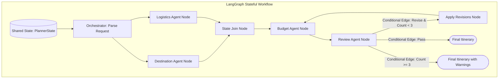
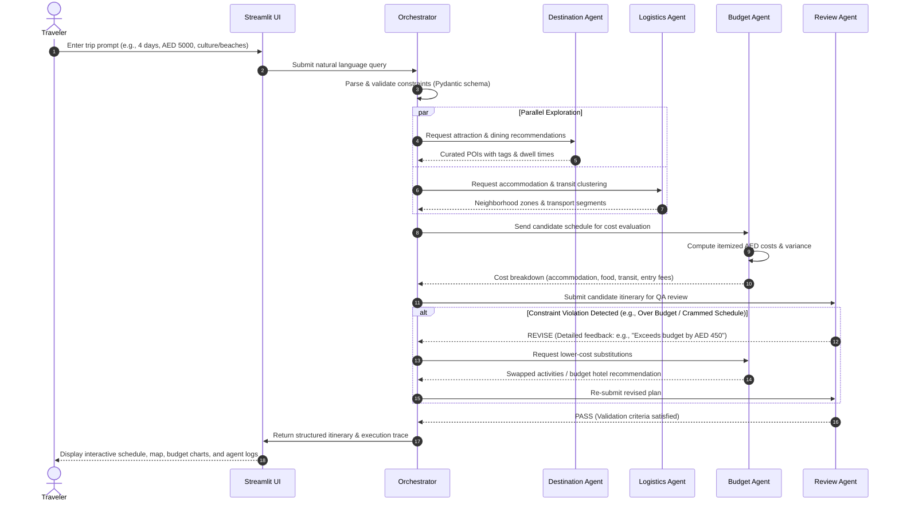

# Dubai AI Travel Planner — Multi-Agent Systems Using LangGraph

## 1. Background

Planning a comprehensive trip involves multiple interconnected and often conflicting decisions:
- Selecting attractions tailored to specific interests.
- Finding suitable accommodations within budget limits.
- Organizing daily transportation and minimizing transit times.
- Estimating detailed expenses and enforcing financial constraints.
- Ensuring the itinerary conforms strictly to personal traveler preferences and schedules.

Traditional single-prompt LLM chatbots typically produce an itinerary in one shot. However, they suffer from critical limitations:
- **No Ground-Truth Verification**: Hallucinations in operating hours, pricing, and locations.
- **Unverified Logistics**: Failure to validate real travel times, route feasibility, or geographical clustering.
- **Poor Budget Enforcement**: Inability to calculate accurate itemized costs or handle budget overflows dynamically.
- **Lack of Feedback Loops**: Incapable of iteratively auditing and revising plans against user constraints.

This project investigates how **collaborative, specialized multi-agent architectures** solve these real-world travel-planning challenges by decomposing responsibilities, maintaining shared state, and enabling iterative feedback loops orchestrated with **LangGraph**.

---

## 2. Problem Statement

Build a **Dubai-focused AI Travel Planning System** that transforms natural-language travel requests into personalized, budget-conscious, practical, and validated travel itineraries.

Rather than relying on a monolithic AI agent, the system divides the planning process across specialized agents coordinated via a stateful computational graph:
1. **Destination research & discovery**
2. **Geographical logistics & scheduling**
3. **Cost estimation & budget enforcement**
4. **Plan validation & quality assurance feedback**

### Core Orchestration Framework: LangGraph
The application leverages **LangGraph** to deliver:
- **Graph-Based Orchestration**: Explicit execution DAG modeling agent dependencies.
- **Shared, Strongly Typed State**: `PlannerState` shared and updated predictably across all nodes.
- **Parallel Execution**: Concurrent execution of destination research and logistics routing.
- **Conditional Decisions & Feedback Loops**: Programmatic routing where a dedicated Review Agent audits the itinerary and triggers bounded revision cycles if constraints are violated.

> **Note**: The goal is not to build a commercial booking platform, but to demonstrate how stateful multi-agent architectures solve complex, constraint-heavy real-world problems through coordinated decision-making.

---

## 3. Example User Request & Expected Outputs

### 3.1 Example User Request
> *"Plan a 4-day trip to Dubai with a budget of AED 5,000, excluding flights. I enjoy cultural attractions, local food, and beaches. I prefer affordable hotels and want to avoid crowded places."*

### 3.2 System Deliverables
The system must generate:
1. **Day-by-Day Itinerary**: Chronological schedule with realistic suggested timings (morning, afternoon, evening).
2. **Curated Recommendations**: Ranked attractions, restaurants, and accommodation neighborhoods matching traveler preferences.
3. **Logistics & Transit Plan**: Recommended transit modes (Metro, Taxi, Bus, Walk) and estimated travel durations between stops.
4. **Itemized Budget Breakdown (AED)**: Category-wise costs (accommodation, dining, activities, local transit) with total projected expenditure.
5. **Dynamic Cost-Cutting Alternatives**: Recommended trade-offs when proposed plans breach budget boundaries.
6. **Validated Final Itinerary**: Plan verified against travel preferences, budget caps, pacing, and geographic coherence.

---

## 4. Multi-Agent System Architecture

The architecture partitions problem-solving among specialized agents interacting over a shared state:

```
+────────────────────────────────────────────────────────────────────────────────────+
|                                  ORCHESTRATOR AGENT                                |
|  - Parses natural language request into structured constraints (dates, budget, etc.)|
|  - Coordinates execution flow and synthesizes agent outputs into final itinerary  |
+──────────────────────────+─────────────────────────────────+───────────────────────+
                           |                                 |
                           v                                 v
        +──────────────────────────────────+ +──────────────────────────────────+
        |    DESTINATION RESEARCH AGENT    | |         LOGISTICS AGENT          |
        | - Researches sights, food, culture| | - Clusters locations geographically |
        | - Applies user preferences/vibes | | - Calculates transit times & routes  |
        +──────────────────────────────────+ +──────────────────────────────────+
                           |                                 |
                           +----------------+----------------+
                                            |
                                            v
                           +----------------──────────────────+
                           |           BUDGET AGENT           |
                           | - Calculates itemized AED costs  |
                           | - Detects budget overflows       |
                           | - Proposes cost-saving swaps     |
                           +----------------──────────────────+
                                            |
                                            v
                           +----------------──────────────────+
                           |           REVIEW AGENT           |
                           | - Audits schedule & constraints  |
                           | - Decision: Pass vs. Revise      |
                           +----------------+-----------------+
                                            |
                         +------------------+------------------+
                         | Pass                                | Revise (Feedback Loop)
                         v                                     v
               [ Final Itinerary ]                   [ Trigger Plan Revision ]
```

### Agent Specifications

| Agent | Role & Responsibility | Core Inputs | Primary Outputs |
| :--- | :--- | :--- | :--- |
| **1. Orchestrator Agent** | Extracts structured constraints from user prompts, orchestrates agent dependencies, manages execution lifecycle, and compiles final deliverables. | User prompt, trip parameters | Structured request schema, execution plan, finalized itinerary |
| **2. Destination Agent** | Researches Dubai attractions, dining options, cultural landmarks, and hidden gems tailored to user interests and crowd preferences. | User interests, trip duration, pace preference | Ranked attraction lists, venue details, recommended visit durations |
| **3. Logistics Agent** | Selects optimal accommodation zones, groups activities geographically to minimize transit, plans routes, and calculates journey times. | Selected attractions, hotel tier preference | Grouped daily clusters, transport recommendations, travel duration matrix |
| **4. Budget Agent** | Estimates category expenses (hotels, food, transit, admissions) in AED, tracks total projected spend against the cap, and suggests lower-cost alternatives. | Itinerary candidates, budget limit (AED), pricing data | Itemized cost breakdown, budget variance, replacement options |
| **5. Review Agent** | Performs automated QA on the full itinerary: checks budget compliance, schedule feasibility, duplicate stops, opening hours, and preference alignment. | Complete proposed itinerary, original user constraints | Audit report (`Pass` or `Revise` with specific feedback instructions) |

---

## 5. Dubai Travel Data — Sources & Integration

To balance real-world accuracy with robust, reproducible demonstrations, data is integrated via a tiered strategy:

### 5.1 Data Requirements & Sources

| Data Requirement | Proposed Source | Usage & Notes |
| :--- | :--- | :--- |
| **Attractions & Culture** | Visit Dubai & Data.Dubai / Dubai Pulse | Curated database of iconic landmarks, cultural heritage sites, beaches, and neighborhood guides. |
| **Venues & Geolocation** | OpenStreetMap (Overpass API) & Local Curated SQLite | Geocoordinates, place types, categories, and opening hours ($0.00 cost). |
| **Routes & Transit** | Official Dubai RTA Open Data & Transit Math Engine | Metro/Bus fares, transit zones, road distances, and estimated travel durations ($0.00 cost). |
| **Accommodations** | Curated Dubai Hotel Dataset | Neighborhood-based hotel pricing tiers (budget, midscale, luxury) and amenities. |
| **Activity & Dining Costs**| Published Dubai attraction fees & curated AED price bands | Realistic baseline costs for meals, entry tickets, and excursions in AED. |
| **Weather (Optional)** | Open-Meteo API | Seasonal/daily heat advisories and indoor vs. outdoor activity suitability (Free, no key). |

### 5.2 Integration Strategy & Reliability Guardrails
1. **Local Curated Fallback**: Seeded SQLite / JSON database containing curated Dubai attractions, hotels, transit zones, and pricing. Ensures the system runs 100% reliably and completely free.
2. **Open-Source Augmentation**: Optional queries to OpenStreetMap (Overpass) for dynamic POIs without requiring paid API credentials.
3. **Data Provenance Transparency**: The output schema clearly tags each piece of data as `verified`, `api_derived`, or `estimated`.
4. **Scope Boundaries**: Live booking reservations, payment execution, and real-time flight tracking are explicitly excluded from initial MVP scope.

---

## 6. LangGraph State Machine Architecture



### Architectural Advantages of LangGraph:
- **Centralized Shared State**: `PlannerState` provides full inspection of every agent's contributions.
- **Deterministic Branching**: Parallel execution of research and logistics without thread race conditions.
- **Cyclic Graph Support**: Native conditional loops (`should_continue`) that allow the Review Agent to send plans back for adjustments.
- **Full Traceability**: Every node transition can be logged, diffed, and displayed in real time on the Streamlit dashboard.

---

## 7. End-to-End Workflow



---

## 8. Technology Stack

- **Language**: Python 3.10+
- **Agent Orchestration**: `langgraph` (StateGraph, conditional edges, cyclic loops, MemorySaver checkpointing).
- **LLM Layer**: Configurable model provider via `langchain-core` / `google-genai` / `openai` / `anthropic`.
- **Validation & Schemas**: `pydantic` (V2) for data validation and schema enforcement.
- **User Interface**: `streamlit` for an interactive, responsive dashboard with real-time graph state visualizer.
- **Data & Storage**:
  - `sqlite3` / `JSON` for local curated Dubai destination data.
  - Zero-cost open sources: OpenStreetMap (Overpass API), Dubai RTA data, Open-Meteo.
- **Visualization**: `plotly` for budget and schedule breakdowns; Leaflet map components for day routes.

---

## 9. MVP Scope & Success Criteria

### 9.1 Initial Scope
- **Geographic Boundary**: Dubai, UAE only.
- **Trip Durations**: 1 to 7 days.
- **Currency**: United Arab Emirates Dirham (AED).
- **Travel Profiles**: Solo, couple, or small group travel with flexible interest tags (culture, beach, culinary, budget, luxury).

### 9.2 Measurable Success Criteria
1. **Natural Language Understanding**: Correctly parse dates, duration, budget caps, and preferences into a validated schema.
2. **Specialized Collaboration**: Clear division of responsibilities across the 5 agents without overlapping tasks.
3. **Realistic Feasibility**:
   - Attractions scheduled within realistic opening hours and reasonable daily travel times.
   - Itineraries geographically grouped (e.g., Old Dubai / Deira on one day, Marina / JBR on another).
4. **Dynamic Budget Audit & Revision**:
   - Correctly trigger a `Revise` feedback cycle when constraints are intentionally breached.
   - Successfully substitute items to bring total costs within the AED ceiling.
5. **Stateful Graph Traceability**:
   - Interactive Streamlit dashboard showing real-time graph node execution and state transitions.

---

## 10. Implementation Roadmap

```
Phase 1: Project Setup & Curated Dubai Data Seed
  ├── Initialize Python environment & dependencies (LangGraph, Streamlit, Pydantic)
  └── Create SQLite/JSON dataset for Dubai attractions, hotel tiers, and RTA transit fares

Phase 2: Data Models & Pydantic Schemas
  ├── Define UserConstraints, AttractionItem, TransitSegment, DailyItinerary, and BudgetBreakdown
  └── Create ReviewFeedback schemas for validation loops

Phase 3: LangGraph Engine Implementation
  ├── Build state schema & agent nodes (Orchestrator, Destination, Logistics, Budget, Review)
  └── Wire parallel branches and cyclic conditional feedback edges with MemorySaver checkpointer

Phase 4: Streamlit Interactive UI
  ├── Trip configuration input panel
  ├── Real-time graph node/state transition visualizer
  ├── Itinerary timeline, map coordinates, and budget breakdown charts
  └── Telemetry panel (latency, token usage, revision counts)

Phase 5: Testing, Evaluation & Benchmarking
  ├── Test constraint edge cases (extreme low budget, impossible schedules, contradictory tags)
  └── Validate circuit breakers and bounded revision limits
```
